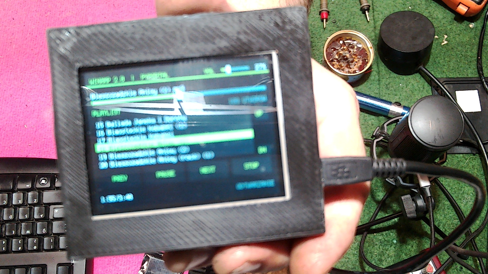
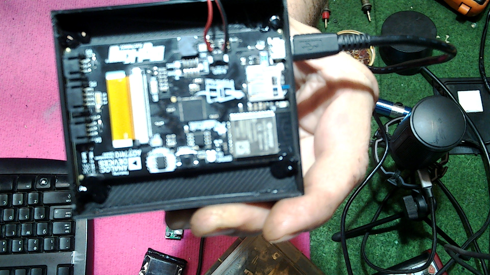

# Winamp 2.0 - przewijanie utworu

To jest osobna wersja odtwarzacza MP3 Winamp 2.0 dla PyPortal. Oryginalny
plik `code.py` w katalogu glownym pozostaje bez zmian.

Przeciagnij suwak nad playlista, aby przewinac odtwarzany utwor do wybranej
pozycji. Po puszczeniu ekranu odtwarzanie rozpocznie sie od ramki MP3
poprzedzajacej wybrany czas; krotki fragment wstepny jest wyciszony, aby
dekoder mogl przygotowac dane potrzebne do poprawnego dzwieku. Czas utworu
jest obliczany z ramek, wiec
suwak dziala rowniez dla plikow ze zmiennym bitrate. Przy wyborze utworu
program probkuje plik zamiast odczytywac kazda ramke. Czas biezacy i calkowity
sa wyswietlane pod przyciskami. Suwak `VOL` w prawym gornym rogu reguluje
glosnosc w zakresie 0-100%; po uruchomieniu ustawione jest 50%.
Mikser ma powiekszony bufor audio, a ekran podczas odtwarzania odswieza sie
raz na sekunde, zeby ograniczyc przerwy i trzaski audio na PyPortalu. Po
uruchomieniu utworu glosnosc narasta przez 5 sekund od zera do poziomu
ustawionego suwakiem. Przy zgodnym formacie audio dwoch kolejnych plikow
utwory nakladaja sie przez 5 sekund; jesli formaty sie roznia albo PyPortal
nie moze przygotowac drugiego dekodera, odtwarzacz przechodzi do kolejnego
utworu bez nakladania zamiast zmieniac predkosc lub wysokosc dzwieku.
Odtwarzacz korzysta z 16-bitowego wyjscia audio. CircuitPython nie pozwala
programowo zwiekszyc fizycznej rozdzielczosci DAC ani taktowania procesora
PyPortala.

Przyciski playlisty, PREV, PLAY/PAUSE, NEXT i STOP dzialaja jak wczesniej.
Skopiuj `code.py` na dysk `CIRCUITPY`, aby uruchomic program. Pliki MP3 umiesc
w katalogu glownym karty SD.

## Zdjecia z PyPortala

